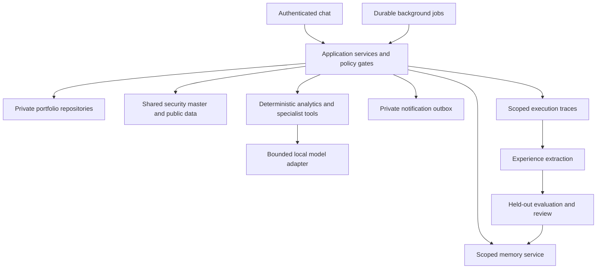

# Reference architecture

## Components

Chat and jobs are planned adapters over the same authorized application services. The model never owns access control, accounting, instrument eligibility or order authorization. Deterministic services calculate quantities and metrics; the model explains evidence and proposes structured actions. A policy gate validates all proposals.

## Candidate specialist roles

| Role | Responsibility | Access |
|---|---|---|
| Portfolio coordinator | Interpret user goal, delegate bounded tasks, assemble evidence | Current user's context only |
| Holdings steward | Import, reconcile identifiers and positions | Authorized portfolio and validation provider |
| Research analyst | Summarize filings and public facts | Public market data; optional scoped question |
| Risk analyst | Concentration, allocation and scenario calculations | Current portfolio, deterministic metrics |
| Monitoring worker | Collect updates, evaluate thresholds and enqueue alerts | Public collection plus separately scoped evaluation |
| Memory curator | Extract candidate lessons, deduplicate, expire and review | Same scope as source runs |
| Evaluation worker | Compare frozen policies on held-out cases | Isolated, consented evaluation data |

These are modules and capabilities first, not mandatory autonomous agents or separate processes. Add agent loops only when evaluation demonstrates value. Tool grants are narrower than role descriptions.

## Flows

Holding import: authenticate → authorize portfolio → validate input → resolve authoritative security identity → atomically register instrument and upsert position snapshot → schedule baseline collection → emit private audit event. Unknown instruments enter a reconciliation queue in M2. M0 raises a validation error instead.

Chat: authenticate → load authorized context → retrieve scoped evidence → calculate deterministic results → optionally call local model → validate response/actions → return evidence with timestamps. Stale/missing data produces an explicit incomplete result.

Proactive: claim due job with lease → establish trusted owner context → collect public data once per security → evaluate each authorized portfolio separately → persist outcome and deduplicated outbox item → deliver according to user preferences. Collection results must not reveal which users hold the instrument.

Learning: trace → outcome/feedback → scoped candidate experience → evidence and contradiction checks → offline evaluation → versioned reviewed procedure → retrieval influences a later tool choice → compare outcomes → rollback on regression. This changes agent behavior without changing model weights.

## Local resource plan

Start with Python, SQLite on local disk and a single bounded local-model adapter. Use deterministic scheduled rules for routine monitoring; invoke the model on meaningful changes or user questions. Cache public observations with source and freshness metadata. Bound prompts, output tokens, queue depth and retries. Measure latency, memory pressure and quality on the actual Mac mini before selecting model size. Portable adapters may use a local HTTP runtime or native inference; neither is required for the offline foundation.

M0 contains core repositories, fixtures, protocols and CLI only. Durable jobs, model orchestration, traces and outbox are intentionally milestone work, not simulated by placeholders claiming success.
